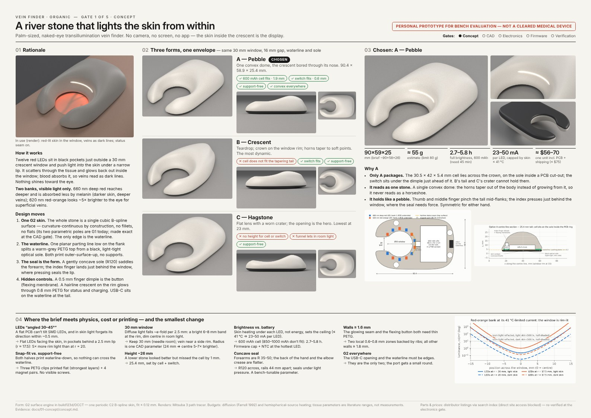

# Vein Finder · Organic

A palm-sized, naked-eye **transillumination vein finder** shaped like a water-worn river stone.
It presses on the forearm and side-lights the skin with visible red light. Veins show as dark
lines inside an open crescent window. There is no camera, no screen and no app: the skin is
the display.

> ### ⚠ Personal prototype for bench evaluation — not a cleared medical device
> Not for diagnosis, treatment or clinical use on patients. Built and documented for
> one person's bench evaluation in a home workshop.



## Status by gate
| Gate | Deliverable | Status |
|---|---|---|
| 1 Concept | one-page concept, three forms as renders, chosen form + why | **done; reviewed 2026-10-11** (answers in `docs/01-concept/concept.md` §9) |
| 2 CAD | parametric build123d model, STEP + print-ready 3MF, wall/fit/overhang reports | **done** — `docs/02-cad/cad.md`; updated at gate 3 for the real parts (errata: three unreported thin floors, now fixed) |
| 3 Electronics | schematic, PCB (KiCad 7), BOM with links and prices | **done** — `docs/03-electronics/electronics.md`; routed board, DRC 0 errors / 0 unconnected; the three open decisions were settled on 2026-10-12 (§7) |
| 4 Firmware | ATtiny1614 C: 3 levels, bank switch, 3-min auto-off, 41 °C limit | **done** — `docs/04-firmware/firmware.md`, `fw/` (host tests pass) |
| 5 Build + verification | print settings, illustrated assembly guide; walls & fits, runtime, thermal, IEC 62471, cost | **done** — `docs/05-build/build.md`, `docs/06-verification/verification.md`; bench checks listed for the first build |

## Layout
```
cad/stone/organic.py        G2 "inflated planform" surface engine (single periodic C2 B-spline skin, G2 poles)
cad/stone/verify_g2.py      ring / seam / equator curvature-continuity tests
cad/concepts/               gate 1: the three concept forms, feasibility, review renders
cad/device/params.py        gate 2: every internal dimension (single source of truth)
cad/device/skin.py          device skin (form A + thumb dish) and inner offset ("cavity") solids
cad/device/layout.py        PCB outline, LED ring, magnets, seam mask, bridge, USB-C from the real cavity
cad/device/parts.py         top shell, sole, seam mask, button bridge + stand-ins for bought parts
cad/device/checks.py        walls, overhang, interference, mass, button force (shell Ritz), magnet pull
cad/device/build.py         build -> BREP cache, STEP, PLY, 3MF, checks
calc/                       physics notes, concept budgets, pinning tests
render/                     Mitsuba 3 studio, concept and CAD renders
docs/01-concept/            concept.pdf (A3 board), concept.md (evidence), renders, figures, STEP
docs/02-cad/                cad.md (gate-2 report), renders, figures, step.zip, 3mf/, pcb/ (DXF + layout.json)
ee/design.py                gate 3: every part, net, footprint and source (single source of truth)
ee/make_schematic.py        KiCad 7 schematic + netlist round-trip check + PDF
ee/placement.py, room.py    placement proved against the shell's headroom and keep-outs
ee/make_pcb.py              board from the CAD outline, Freerouting, pours, DRC, Gerbers
ee/finish_route.py          routing finisher: edge-rule rip-up, remaining joins, GND stitching
ee/silk.py                  silkscreen tidy-up (references, labels)
ee/make_order.py            order pack (docs/07-order) from the BOM
ee/make_bom.py              BOM (CSV + Markdown) with order quantities and cost
ee/kicad/                   KiCad project (schematic, PCB, project rules)
ee/lib/                     project symbols and footprints (libgen.py)
fw/                         gate 4: ATtiny1614 firmware (src/), host tests (test/), Makefile
docs/03-electronics/        electronics.md, bom, budget.py, optics.py, figures, fab/ (Gerbers, drill, pos)
docs/04-firmware/           firmware.md
docs/05-build/              build.md: print settings and the illustrated assembly guide
docs/06-verification/       verification.md, thermal.py, iec62471.py
docs/07-order/              order.md: PCB settings and cart files for Digi-Key, LCSC, Adafruit
tools/fetch.sh              fetches KiCad 7 library files, Freerouting and avr-gcc into build/
build/                      generated (gitignored)
```

## Rebuild
```bash
pip install -r requirements.txt
# gate 1
cd cad/concepts && python build_concept.py A && python feasibility.py
cd ../../calc && python -m pytest -q && python concept_budget.py
cd ../render && python concept_renders.py
cd ../docs/01-concept && python figures.py && python build_pdf.py
# gate 2
cd ../../cad/device && python layout.py && python build.py --force --3mf --checks && python verify_skin.py
cd ../../render && python cad_renders.py --spp 128 --scale 1.0
cd ../docs/02-cad && python figures.py && python package.py
# gates 3-5 (KiCad 7 + Java for Freerouting; tools/fetch.sh gets the rest)
cd ../.. && tools/fetch.sh
python ee/libgen.py && python ee/make_schematic.py && python ee/make_bom.py && python ee/make_order.py
python ee/make_pcb.py --no-fab && python ee/finish_route.py && python ee/make_pcb.py --stage finish
python ee/plot_pcb.py && (cd docs/03-electronics && python budget.py && python optics.py)
make -C fw test && make -C fw
(cd docs/06-verification && python thermal.py && python iec62471.py)
```
