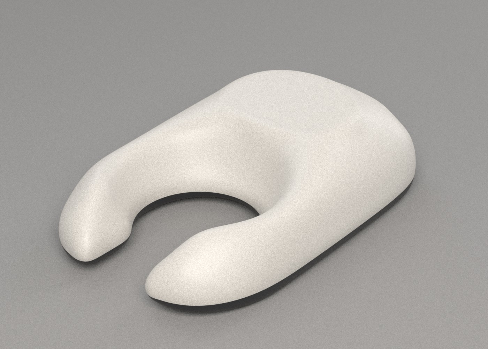
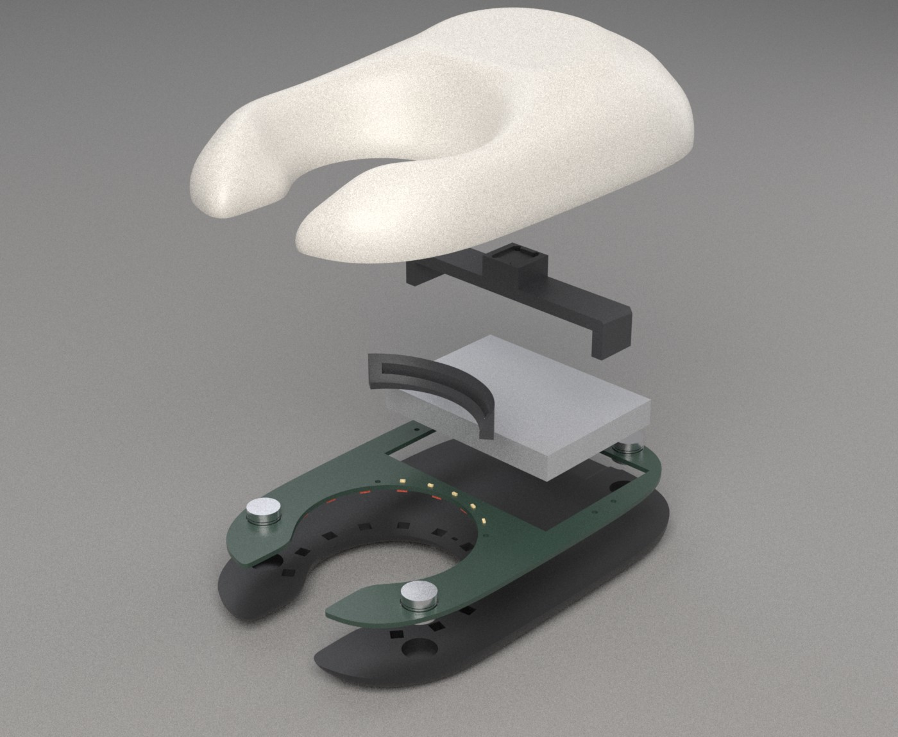
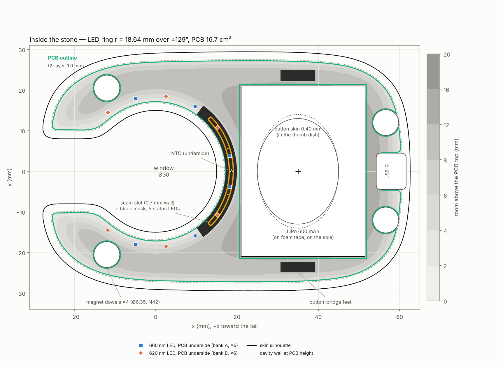
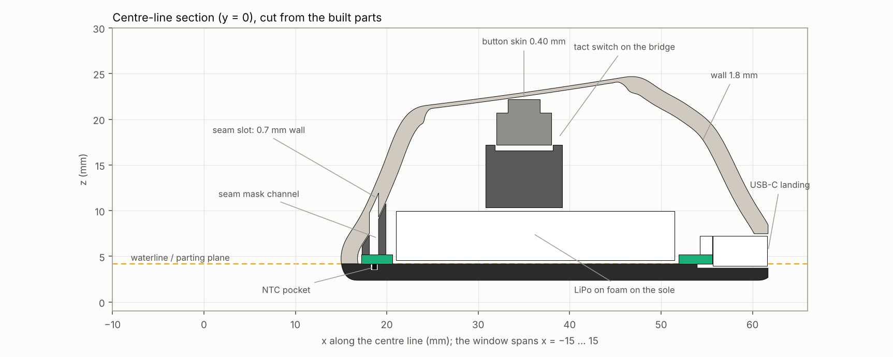
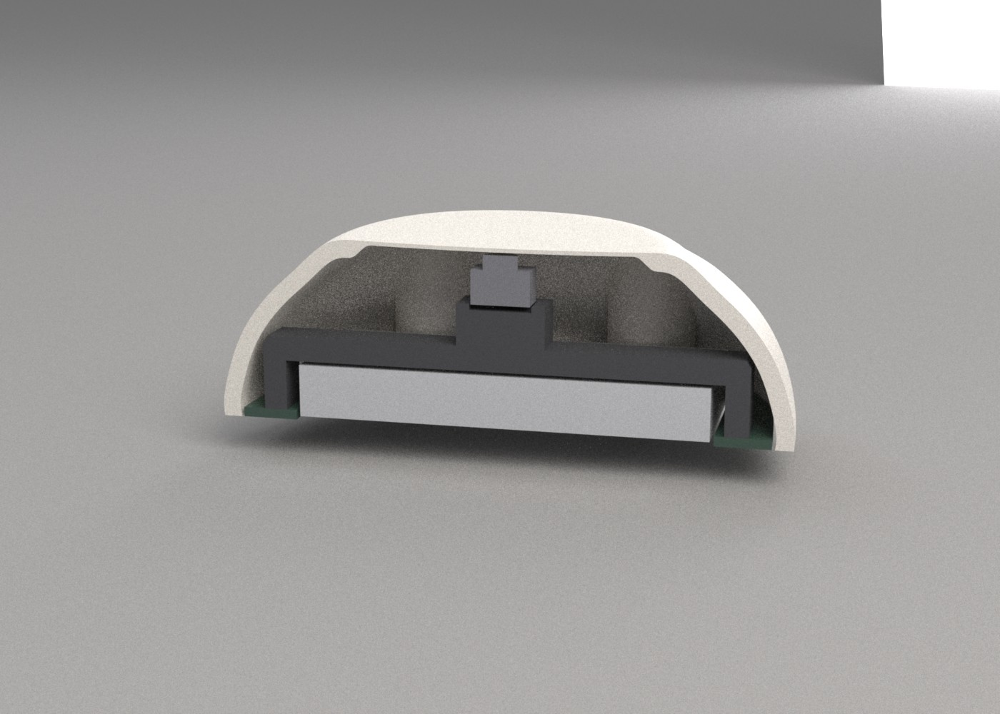
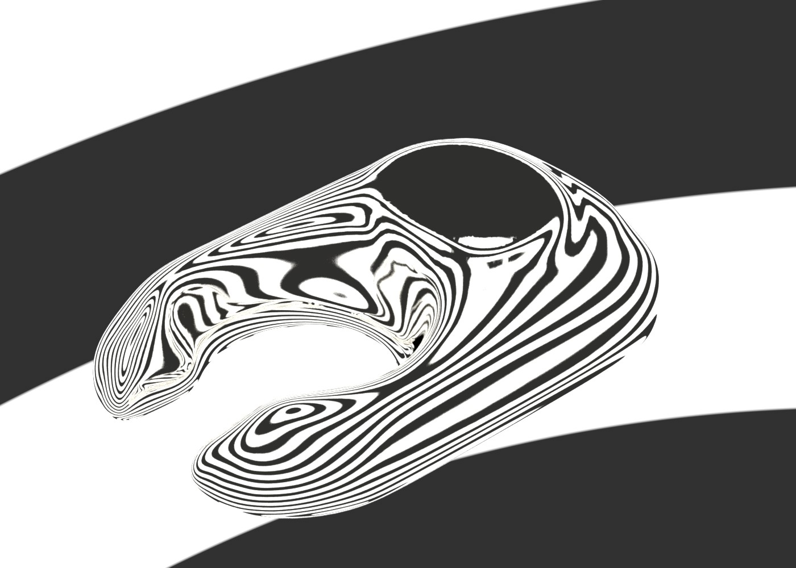

# Gate 2 — CAD

> **Personal prototype for bench evaluation. Not a cleared medical device.**
> Not for diagnosis, treatment or clinical use. The numbers below are engineering checks
> of the model, not a safety case.



## 1. Summary

The approved form A "Pebble" is now a parametric build123d model of four printed parts:
- **top shell:** warm-grey PETG;
- **sole:** black PETG;
- **seam mask:** black PETG;
- **button bridge:** black PETG.

The model also carries stand-ins for every bought part, so the assembly can be checked for
fits and interference. Every figure in this note is measured on the built solids by
`cad/device/checks.py` and `cad/device/verify_skin.py`.

| | Result | Brief / limit |
|---|---|---|
| Size | **90.2 × 58.9 × 24.7 mm** | about 90 × 58 × 26 |
| Mass (estimate) | **53.9 g** | < 80 g |
| Skin continuity | **G2 everywhere**, poles included (§5.1) | G2 everywhere |
| Walls | **1.80 mm** general minimum; thin spots 0.70 mm (seam) and 0.40 mm (button) | ≥ 1.6 mm; two approved thin spots |
| Cosmetic surfaces, support-free | top-shell skin max overhang **21.5°**; sole skin **none** | yes |
| Interference between the 12 parts | **none** | none |
| Button press force | **3.0–3.6 N**, about 2.7 N once the switch is shimmed to zero gap | comfortable, hidden |
| Closure pull, 4 magnet pairs | **33 N** | snap-free closure, magnets only |
| Parting lines and edges | one planar waterline; one flat landing at the USB-C port | one parting line |

## 2. What changed from the concept, and why

1. **Button moved onto the crown, into a worry-stone thumb dish.**
   - The concept's dimple sat at x = 20.5 on the window's back wall, at a 46–57° slope.
     Pressing there pushes the stone along the arm, and the switch only gets about half
     of the skin's movement.
   - Physics: a curved 0.45 mm PETG skin behaves as a shell, not a plate. A shallow-shell
     Ritz model of the real skin gives **36.5 N/mm**, against 7.3 N/mm for the same skin
     flat. That means a **16 N** press.
   - Smallest change: a shallow dish, 20 × 28 mm, at x = 35 on the front of the crown. It
     sits 2.2 mm below the old surface, has a curvature radius of 500 mm, and is
     G2-blended over 6 mm. The skin in it is 0.40 mm.
   - Result: **6.8 N/mm and a 3.0–3.6 N press**. Pressing now also pushes the window onto
     the arm, which helps the light seal.
   - Compare the hero render above with the concept board.
2. **Button skin 0.40 mm**, a little under the "about 0.5" given at review. Thicker skins
   raise the press force: 0.45 mm gives about 4.0–4.6 N.
3. **The switch is held on a printed bridge.**
   - The bridge stands on the PCB's two side arms, spans the battery, and holds a 6 × 6
     THT tact switch with its plunger under the skin. It needs no glue: pressing the
     button pushes it down onto the board.
   - The switch is hand-wired to the board with two wires.
4. **Magnets only, used as dowels (your choice at review).**
   - Each sole magnet (1/4″ × 1/8″) stands 0.5 mm proud of the PCB, through a board hole,
     into a counterbore in the top boss. That aligns the halves and locates the board.
   - The top magnet (1/4″ × 1/16″) sits 0.15 mm above it.
5. **LED ring at r = 18.64 mm over ±129°, not ≈ 17.5 mm.**
   - The board can't reach under the top shell's 1.8 mm window wall. Its inner edge sits
     at r = 17.22 mm, so the ring sits further out once pad and edge clearances are added.
   - This costs rim brightness. The rim is 2.9–3.0× the concept's r = 20 mm baseline,
     against 6.6–7.2× at r = 17.5. In other words, about 2.3× less light at the rim than
     the concept's best case. That is still 2–13× the room-light veil across skin types.
   - Not done, and needs your decision (§7): a 1.2 mm-tall relief at the base of the bore
     would let the board reach r ≈ 16.3 and restore most of that. It is a third thin spot
     (0.9 mm, hidden, backed by the board).
6. **Battery moved forward**, to x = 21.0–51.5. Nothing sits in front of it now, which
   frees the tail for USB-C and two magnets.
7. **USB-C port landing.**
   - The tail tip is a rounded edge, 5 mm thick at x = 62. A plug's overmold can't seat
     against a curved tip.
   - So the port sits in one flat landing, 13.8 mm wide and 0.9 mm deep at the tip, with
     1.5 mm plan rounds.
   - Together with the waterline, this is the skin's only edge.
8. **Locating pins are wire.** Pins moulded under a part that prints flat-side-down can't
   be printed. The seam mask and the bridge take short pieces of 1.0 mm brass or steel wire
   (3 mm long) in blind holes. They locate in matching PCB holes.

## 3. Parts

| Part | Material | Print orientation | Volume | Mass |
|---|---|---|---|---|
| top shell | warm light-grey PETG | waterline face on the plate | 12.8 cm³ | 16.0 g |
| sole | black PETG | turned over, waterline face on the plate | 10.5 cm³ | 10.7 g |
| seam mask | black PETG | PCB face on the plate | 0.21 cm³ | 0.3 g |
| button bridge | black PETG | on its side (x-face) | 1.5 cm³ | 1.6 g |

Bought parts, with their stand-ins in the assembly:
- PCB: 2-layer, 1.0 mm, 16.7 cm²
- LiPo: Jauch LP503040JH
- 4 + 4 N42 magnets
- 12 LEDs (2.0 × 2.0 mm class)
- NTC (0402)
- 6 × 6 THT tact switch (5.0 mm)
- USB-C mid-mount receptacle (sink type)
- 5 status LEDs (0402)

Part numbers and prices are fixed and verified at the electronics gate.



## 4. Layout



- **LEDs:** 12, on the PCB underside, at r = 18.64 mm. Six per bank, alternating and
  mirror-symmetric, 23.45° apart.
- **LED pockets:** each is a straight black light channel through the sole, 2.4 × 2.4 mm.
  The lip between the window edge and the pocket openings is 2.4 mm wide.
- **NTC:** on the PCB underside at (18.64, 0), in a sole pocket 0.7 mm deep. It sits
  between the two LEDs nearest the window's back.
- **Seam:** the slot runs along r = 18.6 mm, ±44°. It is 0.5 mm wide in plan, which is
  about 1 mm along the 68° wall, and leaves 0.68 mm of wall.
  - A black mask, a closed frame around a 1 mm channel, stands on the PCB and carries
    light from five status LEDs to the slot.
- **Button:** the bridge stands on the side arms at x = 35. Its deck clears the battery by
  0.4 mm. The switch pedestal top is at z = 17.19 and the skin underside at 22.24, which
  leaves a 0.05 mm gap above a 5.0 mm switch.
- **Magnets:** two at the horns, (−12, ±20.5), and two at the tail, (56.6, ±12). At least
  1.57 mm of PETG covers each top pocket.
- **USB-C:** face at x = 61.6, centre 1.42 mm above the waterline. The PCB has a 6.0 mm
  notch where the receptacle body sinks into it.
- **Room above the PCB:** the shading in the figure.
  - Window crescent: 2–4 mm.
  - Horn tips: 0–2 mm.
  - Side arms and tail: 4–8 mm.
  - It sets the component heights at the electronics gate.





## 5. Verification

Sources: `build/device/checks.json` and `g2.json`, reproduced by the commands in §8.

### 5.1 G2 skin

The outer skin is one periodic cubic B-spline, 168 × 60 control points. It fits the
analytic surface within 0.105 mm max and 0.003 mm RMS.

**The two poles are now G2.** The first three control rows at each pole are constrained.
Row 0 is the pole point, row 1 lies in the tangent plane, and row 2's normal offsets
reproduce the surface's own second fundamental form (`organic.py`, `fit`). Ring test,
mean curvature H on circles around the pole:

| ring radius | 0.05 mm | 0.2 mm | 0.8 mm | 1.6 mm |
|---|---|---|---|---|
| crown pole, before (G1) | 20 /mm | 2.5 /mm | 0.29 /mm | 0.13 /mm |
| crown pole, now | 1.6·10⁻⁴ /mm | 5.4·10⁻⁴ /mm | 2.0·10⁻³ /mm | 3.7·10⁻³ /mm |
| sole pole, now | 3.1·10⁻⁴ /mm | 1.2·10⁻³ /mm | 3.9·10⁻³ /mm | 4.7·10⁻³ /mm |

Before, the scatter blew up as the ring shrank. Now it falls linearly to zero, which is
what a C2 surface with a non-zero curvature gradient does.

- **u-seam:** curvature jump 7.9·10⁻⁸ /mm.
- **Equator:** 5.5·10⁻⁶ /mm. This is the line where the top and underside height fields
  meet.
- **Dish rim:** the dish's front and back rims are tight, about 6 mm radius, but
  continuous. Along the centre line, mean curvature changes by 0.084 /mm per 0.5 mm step
  and by 0.009 /mm per 0.05 mm step. The change scales with the step, so there is no
  jump.

Zebra stripes on the outer skin (below) run unbroken everywhere. The dish reflects one wide
stripe, as a near-flat area should.



### 5.2 Walls and thin spots

- **Wall thickness:** sampled at 805 000 points over the top-shell skin, against the inner
  surface samples. Outside the designed spots, the minimum is **1.800 mm** and the median
  1.800 mm. The inner surface's B-spline fit adds at most ±0.04 mm, so the wall is
  ≥ 1.76 mm.
- **Button skin:** 0.40 mm, tapering back to 1.8 mm over 2 mm with a C2 profile. It has
  no stepped edge to start a crack.
- **Seam slot:** a vertical probe through the slot finds 1.78 mm of material on the 68°
  wall, which is **0.68 mm** normal. Beside the slot it finds 4.73 mm, which is 1.8 mm
  normal.
- **Mirror check:** every part's two halves (y > 0, y < 0) agree within **0.05 %** of
  volume. That rules out silent boolean failures, which are rarely symmetric.

### 5.3 Printability

- **Top shell, waterline down:** skin overhang ≤ **21.5°**, so it needs no supports. The
  interior ceiling, 2 190 mm², needs supports from the build plate only. They come out
  through the open waterline face.
- **Sole, turned over:** skin overhang **none**. The interior roofs of the magnet and NTC
  pockets total 197 mm² and are short bridges.
- **Seam mask:** prints base-down with no supports.
- **Bridge:** one constant 8.4 mm width, so it prints flat on its side with no supports.

### 5.4 Fits and interference

Pairwise intersections were checked between all 12 parts and stand-ins: **none**.

Designed clearances:

| Interface | Clearance |
|---|---|
| PCB edge to cavity wall | 0.3 mm |
| Cell to PCB cut-out | 0.4 mm |
| Cell top to shell, minimum | 4.2 mm |
| Bridge deck to cell | 0.4 mm |
| Bridge to shell | ≥ 0.6 mm |
| Mask tops to shell | 0.10 mm |
| Top boss to PCB | 0.05 mm |
| Magnet faces | 0.15 mm |
| Magnet pockets | 0.15 mm on diameter |
| Dowel counterbore | 0.25 mm on diameter |
| USB-C opening | 0.25 mm per side |

### 5.5 Button press force (model)

The model is a linear shallow-shell (Marguerre) Ritz model, run on the real skin shape
and the real thickness field:
- E = 2.0 GPa, ν = 0.38;
- clamped where the wall is back at 1.8 mm;
- finger patch radius 3.5 mm.

| Skin | Stiffness | Press, 1.0 N switch | Press, 1.6 N switch |
|---|---|---|---|
| concept dimple, 0.45 mm | 36.5 N/mm | 15.6 N | 16.2 N |
| thumb dish, 0.40 mm (built) | **6.8 N/mm** | **3.0 N** | **3.6 N** |

The press is stiffness × (0.05 mm gap + 0.25 mm travel) + the switch force.
- **Uncertainty:** about ±30%. The model is linear, and printed PETG's modulus varies with
  layer direction.
- **Shim:** if the actuator stops short of the skin, the assembly guide's shim step
  (0.1 mm Kapton) removes the dead travel.

### 5.6 Magnets

- **Model:** coaxial current-loop. Each disc is a solenoid sheet with K = Br/μ0 and
  Br = 1.29 T for N42. The pairs are 1/4″ × 1/8″ against 1/4″ × 1/16″ at a 0.15 mm gap.
- **Result:** **8.3 N per pair, 33 N in total**. That is firm enough that it won't pop
  open in the hand. To open it, pry at the tail.
- **Glue and polarity:** the magnets are epoxied in. Glue all sole magnets with the same
  pole up, and check each pair attracts before the glue sets.

### 5.7 Mass

| top shell | sole | mask + bridge | PCB | cell | magnets | electronics | other | **total** |
|---|---|---|---|---|---|---|---|---|
| 16.0 | 10.7 | 1.9 | 3.7 | 12.1 | 4.5 | 3.0 | 2.0 | **53.9 g** |

## 6. Print settings (Creality K2 Pro, 0.4 mm nozzle, PETG)

Starting points. Tune the temperatures to your filament's datasheet.

| | Top shell (warm grey) | Sole (black) | Seam mask (black) | Bridge (black) |
|---|---|---|---|---|
| Orientation | waterline face down | turned over, waterline face down | base down | on its side |
| Layer height | adaptive 0.08–0.16 mm, or a fixed 0.12 | 0.16 mm | 0.12 mm | 0.2 mm |
| Walls | 5 lines (solid 1.8 mm wall) | 4 | 2 (0.8 mm fences) | 3 |
| Infill | 100 % (shell is all wall) | 30 % gyroid | — | 40 % gyroid |
| Top / bottom | 6 / 4 | 6 / 4 | 4 / 3 | 4 / 4 |
| Supports | **tree, build plate only**, for the interior | none | none | none |
| Support Z gap | 0.2 mm, 2 interface layers | — | — | — |
| Brim | 3 mm | none | 5 mm | none |

Settings for all parts:
- **Temperatures:** nozzle 235–245 °C, bed 75–80 °C, part fan 30–50 %, bridges 100 %.
  Keep the chamber lid open for PETG.
- **Plate:** use textured PEI. On smooth PEI, use glue stick as a release agent.
- **Flatness:** the two waterline faces must be flat to sit flush. Turn on elephant-foot /
  first-layer compensation, 0.10–0.15 mm.
- **Thin spots:** turn on "detect thin walls". The 0.40 mm skin and 0.7 mm seam come out
  as 2–5 layers on the shallow crown, so check the preview before printing.
- **Removing supports:** clip the interior tree supports out through the open waterline
  face. Keep tools away from the button skin and the seam slot.
- **Filament use:** about 16 g grey and 13 g black, plus supports.

## 7. Requirement conflicts and decisions needed

| Brief | Problem found in CAD | Smallest change | Status |
|---|---|---|---|
| Hidden button under a flexing printed membrane | A curved 0.45 mm skin is 5× stiffer than a flat one, giving a 16 N press. | Worry-stone thumb dish (near-flat) with a 0.40 mm skin, giving 3.0–3.6 N. | **Done**; please confirm the dish look. |
| G2 everywhere, no flat faces | The tail tip is too thin and curved for a USB-C plug to seat. | One small flat landing at the port, 13.8 × ~6 mm, 0.9 mm deep. | **Done**. |
| LEDs about 17.5 mm from the window centre (concept) | The 1.8 mm window wall keeps the board out, so the ring sits at 18.64 mm and the rim is about 2.3× dimmer than the concept's best case. | Optional third hidden thin spot: a 1.2 mm-tall, 0.9 mm wall relief at the bore base gets the ring to ≈ 17.7 mm. | **Your decision.** Not done; default keeps all walls ≥ 1.6 mm. |
| Concept's LEDs (2835 packages, 2.8 mm wide radially) | The ring assumes ≤ 2.0 mm packages; 2835 parts would push it to 19.0 mm, costing about 25 % more rim light. | Pick 2.0 × 2.0 mm (or smaller) LEDs at the electronics gate. | Electronics gate. |

Fixed at the electronics gate, against this layout (`build/device/layout.json`):
- LED package ≤ 2.0 × 2.0 mm
- 6 × 6 THT tact switch, 5.0 mm, about 1 N
- Sink-type USB-C receptacle, centre 0.42 mm above the PCB top
- 0402 NTC on the underside
- 5 status LEDs (0402) in the mask channel
- Magnets
- Exact battery dimensions

## 8. Files and how to rebuild

| File | What |
|---|---|
| `step.zip` | STEP for each printed part, plus the coloured assembly |
| `3mf/*.3mf` | print-ready meshes, already in print orientation |
| `pcb/pcb_edge_cuts.dxf` | board outline and holes, layer Edge.Cuts, top view (y mirrored for KiCad) |
| `pcb/layout.json` | positions of every LED, the NTC, status LEDs, magnet and pin holes, USB-C, button and battery bay |
| `checks.json`, `g2.json` | raw verification output |
| `renders/`, `figures/` | the images above |

```bash
cd cad/device
python layout.py                         # cavity survey, PCB outline, LED ring -> build/device/layout.json + DXF
python build.py --force --3mf --checks   # all parts -> BREP cache, STEP, PLY, 3MF, checks.json  (~25 min)
python verify_skin.py                    # G2 report -> build/device/g2.json
cd ../../render && python cad_renders.py --spp 128 --scale 1.0
cd ../docs/02-cad && python figures.py && python package.py
```

Every dimension lives in `cad/device/params.py`, and the form lives in `cad/device/skin.py`.
Change a value and rebuild: the layout, the parts and the checks all follow.
