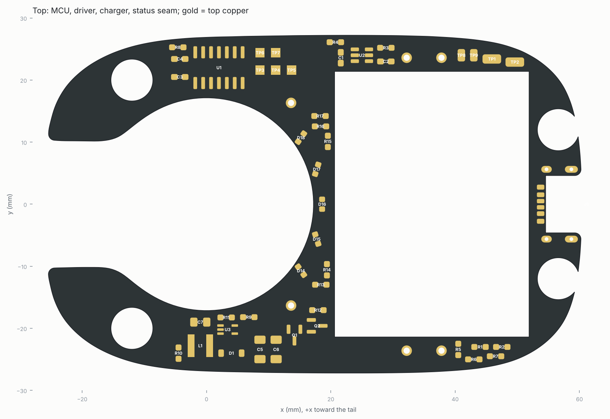
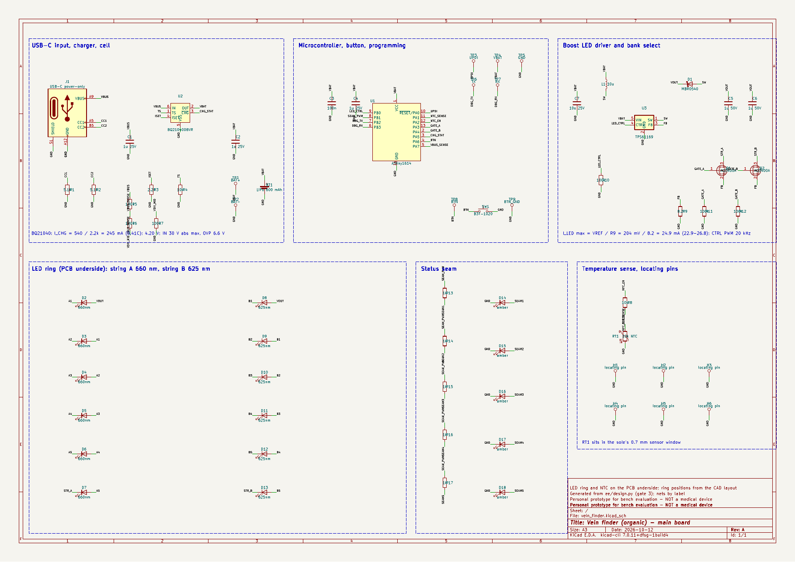
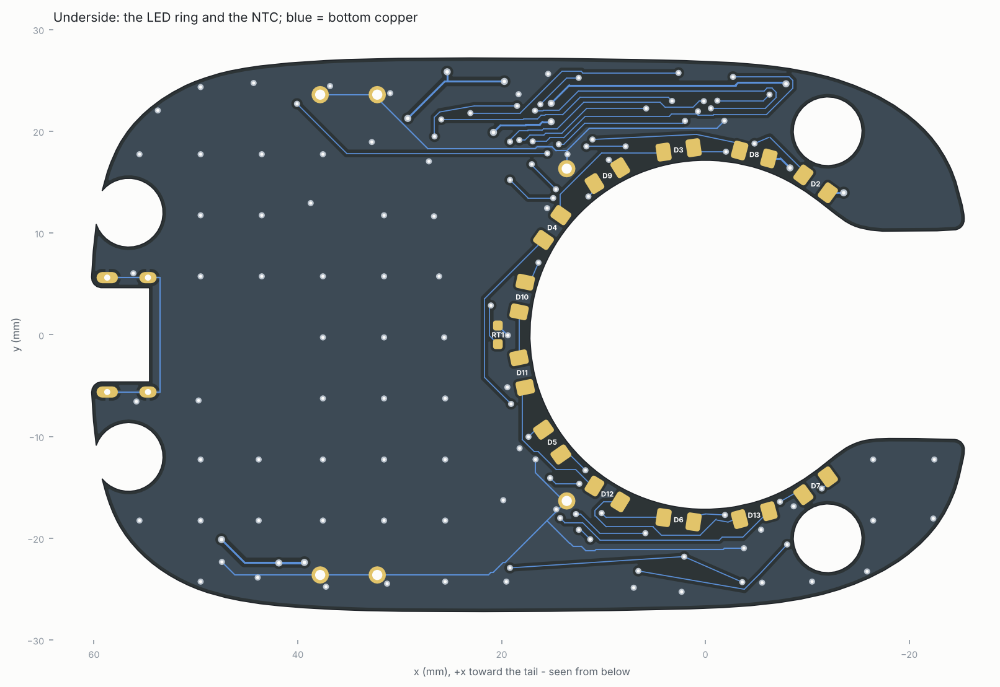

# Gate 3 — Electronics

> **Personal prototype for bench evaluation. Not a cleared medical device.**
> Not for diagnosis, treatment or clinical use. The numbers below are engineering
> estimates and checks, not a safety case.



## 1. Summary

| | Result | Brief / limit |
|---|---|---|
| Board | 2-layer FR-4, 1.0 mm, outline taken from the CAD cavity, 30.0 cm²; the cell sits on it | fits the stone |
| Parts | 65 on the board, 2 wired (cell, switch); every one hand-solderable with an iron | soldering iron only |
| Sourcing | every part listed at Digi-Key, LCSC or Adafruit, with a level (A/D/NV) per line | only in-stock parts, never guess |
| Cost, one device | **$42.04 parts + $5–15 PCB = $47–57** (shipping excluded) | ≤ $75 |
| Runtime, full brightness | **4.5 h** (625 nm) / **5.1 h** (660 nm) from 600 mAh | ≥ 45 min |
| Charging | USB-C, 245 mA (223–268 mA), about 3 h; input survives 30 V | — |
| Standby | 3.7 µA + the cell's protection circuit | — |
| LED current | 24.9 mA ceiling in hardware (22.7–27.1 mA worst case); caps 23 / 24.9 mA set by firmware | LED max 30 mA |
| Skin-face temperature | NTC 0.7 mm under the face; firmware derates from 38 °C, off at 41 °C | ≤ 41 °C |
| Schematic ↔ design | netlist exported by kicad-cli matches `design.py` net for net | — |
| PCB | routed on 2 layers; **DRC 0 errors, 0 unconnected** (§4) | — |

Pages for distributors and manufacturers could not be opened from this environment: the
proxy blocked them with HTTP 403. Every price, stock figure and part number below
therefore comes from search-engine snippets of those pages, or from aggregators.
- Every line was looked up on 2026-10-11 and re-checked on 2026-10-12.
- Cached copies of the same page often disagree. Each line gives the range seen, and the
  BOM prices it at the highest value found on the part's own product page.

**Check every line on the live page before ordering.**

## 2. Circuit



[Schematic PDF](../../ee/kicad/vein_finder_schematic.pdf) · KiCad 7 project in `ee/kicad/`.

- **Power path.** USB-C (GCT USB4515, power-only) has 5.1 kΩ pull-downs on CC1 and CC2, so
  any USB-C source gives 5 V. That feeds a **TI BQ21040** linear charger:
  - 4.20 V termination;
  - 245 mA, set by R3 = 2.2 kΩ (I = K_ISET / R_ISET, K_ISET 490/540/590 A·Ω);
  - input rated to 30 V, with over-voltage cut-off at 6.6 V;
  - TS tied to GND through 10 kΩ, as the datasheet says for a pack without a thermistor;
  - /CHG is open drain, so it goes straight to the MCU.

  The cell is a **Jauch LP503040JH+PCM** (600 mAh min, protected). The MCU and the boost
  driver run straight from it, with no regulator.
- **MCU: ATtiny1614.** It runs from 1.8 V to 5.5 V, so it works from the cell directly.
  - It reads the cell voltage against its internal 1.1 V reference, so no divider is needed.
  - It is programmed over UPDI on one pad.
  - Its pin map is in `ee/design.py` and in [firmware.md](../04-firmware/firmware.md).
- **LED driver: TI TPS61169**, a 1.2 MHz boost.
  - It drives one string of six LEDs at a time, at about 13 V.
  - **Two strings share one sense resistor**, R9 = 8.2 Ω. The current is VREF / R9, so
    24.9 mA (22.7–27.1 mA) is the most any LED can see.
  - The MCU's 20 kHz PWM on CTRL scales VREF, so dimming is analog (no flicker).
  - Q1 and Q2 (AO3400A, 30 V) select the bank. A 30 V part keeps an off FET below its
    breakdown even when VOUT reaches the 36–39 V open-LED protection; a 20 V part would not.
  - D1 is a 40 V Schottky, above the 39 V protection maximum. C5 and C6 are two 1 µF 50 V
    X7R in 1206, giving ≥ 1 µF after DC bias; the datasheet asks for 1–4.7 µF.
- **Strings.** String A has six 660 nm LEDs, string B six 625 nm LEDs.
  - Both start at the +y horn (VOUT) and walk the ring to the −y horn.
  - The bank FETs sit on the −y arc, so the two return lines (STR_A, STR_B) that carry the
    25 mA back to them are short.
- **Sensing and indication.**
  - NTC RT1 (10 k, B 3380 K) sits in the sole's sensor window. Its divider (R8 = 10 k)
    is powered only while it is being read.
  - A 100 k / 200 k divider tells the MCU when USB power is present (3.33 V at 5 V).
  - Five amber 0603 LEDs in the mask channel light the seam, through 1 kΩ each from one
    PWM pin (about 2 mA each).
- **Defaults when the MCU is in reset or unprogrammed.** R10 holds CTRL low, so the driver
  is off. R11 and R12 hold the bank gates low.

## 3. Parts, and what they changed in the CAD

Full list with links, prices, order quantities and verification:
[`bom.md`](bom.md) / [`bom.csv`](bom.csv).

Key choices:

| Function | Part | Why | Verified |
|---|---|---|---|
| 660 nm LEDs | SunLED XZM2MR55W-3, 1206 dome, Digi-Key 1497-1364-1-ND | 30 mA, 1.6 mm wide radially, in stock | A: $0.48–0.54 @10, 3,264–17,861 in stock |
| 625 nm LEDs | SunLED XZM2CRK55W-3, 1206 dome, Digi-Key 1497-1405-1-ND | same package, 1.80 mm tall | A: $0.326 @10, 16,312 in stock |
| Boost driver | TI TPS61169DCKR, LCSC C71045 | 2.7 V minimum input, analog PWM dimming | A: 8,475–33,765 in stock; **Digi-Key: backorder** |
| Charger | TI BQ21040DBVR, LCSC C202311 (Digi-Key 296-47315-1-ND) | 30 V input, OVP, open-drain status | A |
| MCU | Microchip ATtiny1614-SSNR, Digi-Key ATTINY1614-SSNRCT-ND | SOIC-14, 1.8–5.5 V, UPDI | A: $0.90, 33,040 in stock |
| USB-C | GCT USB4515-GF-A, Digi-Key 2073-USB4515-GF-ACT-ND | power-only, 6 pads at ≥ 1.0 mm pitch (easy with an iron) | A: $0.61, 11,429 in stock |
| Cell | Jauch LP503040JH+PCM+2WIRES50MM, Digi-Key 1908-…-ND | 600 mAh protected, 42 × 30.5 × 5.4 mm | A: $10.81, 1,637 in stock |
| Magnets | Radial Magnets 8193 (1/4 × 1/8″) and 8195 (1/4 × 1/16″), N35 | only N35 is stocked in these sizes | A |
| Locating pins | posts from a Sullins PRPC040SAAN-RC header | 18 AWG bus wire is only sold as 100 ft spools (~$140) | A: $1.23 (one result shows $0.55) |

The parts changed the gate-2 model as follows. All of these are in the CAD now and
re-checked (§5 of [cad.md](../02-cad/cad.md) and `checks.json`):

1. **LEDs became 1206** (3.2 × 1.6 mm).
   - The radial width (1.6) is under the 2.0 mm budget, so the **ring moves in to
     r = 18.36 mm** (was 18.64). That is about 20 % more rim light.
   - The 660 nm dome is up to 2.10 mm tall and the 625 nm up to 1.80 mm. The sole is
     thinnest (1.81 mm) at ±11.7°, so **the banks swapped places**: the shorter 625 nm
     parts sit there.
   - No dome stands proud of the skin face, even at maximum height. The worst is flush.
   - The light channels now run 0.15 mm past the solder lands at each end. Without that
     the sole would need shallow reliefs over the lands, which would thin it below 1.6 mm.
2. **NTC became 0603**, lying tangentially at θ = 0, just outside the LED ring
   (r = 20.4 mm).
   - It first lay radially between the two 625 nm LEDs, but there its inner pad was boxed
     in by the LED lands and could not be routed.
   - Its pocket leaves **0.70 mm** of PETG under it: a sensor window. See §7.
3. **Magnets are N35**, the only grade sold in these sizes.
   - Closure pull is **24.1–25.8 N** (gate 2 assumed N42: 33 N).
   - Fixing the floors (next item) also moved the horn dowels to y = ±20.0, raised them
     to 2.0 mm proud, and made the tail a 1/16″ + 1/16″ pair.
4. **Gate-2 errata: thin floors that gate 2 did not report.** Gate 2's wall check sampled
   only the top shell. Probing the sole now found:
   - 0.67 mm under the tail magnets;
   - 1.31 mm at the edge of the horn-magnet pockets;
   - 1.34 mm under the USB-C port.

   The magnet floors are now **1.82 mm** (horns) and **1.67 mm** (tail). The USB-C floor
   (1.15 mm) is accepted as a hidden thin spot (§7).
5. **Locating pins** are now header posts.
   - They are soldered into plated 1.0 mm holes from the underside. The printed part on
     top acts as the squaring jig.
   - The mask's pins moved out into two ears, so they clear the LED lands by 1.1 mm.
   - The sole has 0.8 mm pockets under the cut pin ends.
6. **USB-C is the GCT USB4515** (mid-mount, 1.6 mm offset). On the 1.0 mm board it hangs
   0.61 mm below the board, into a pocket in the sole.
   - The face moved back to x = 61.1. The flat landing is now about 1.4 mm deep at the tip.
7. **The seam mask channel widened to 1.3 mm**, so the status LEDs' 0.95 mm lands sit
   inside it with clearance.
8. **The cell now sits on the board**, on foam tape, and the board has no bay cut-out.
   - Gate 2 cut a bay into the board for a cell resting on 0.4 mm tape on the sole.
   - The only small double-sided foam tape found at the four distributors is Adafruit
     5019, listed as both 1.0 mm and 1.6 mm thick. At that thickness the cell's underside
     is level with or above the board top, so the cut-out bought nothing.
   - The cut-out also split the board into two halves joined by a 3 mm neck at the window
     and a 1 mm strip behind the USB pads. About twelve nets had to cross between them,
     and the board could not be routed.
   - The board under the cell is now a component keep-out; traces may cross it. It is
     marked on the silkscreen.
   - The cell top is 1 mm higher. That leaves ≥ 2.15 mm to the shell, and the bridge deck
     rises with it.

## 4. PCB




| | |
|---|---|
| Board | 2 layers, FR-4 **1.0 mm**, 1 oz; 85.7 × 54.4 mm (85.8 × 54.5 mm over the 0.1 mm edge line), 30.0 cm²; outline taken from the CAD (`build/device/layout.json`), with the four magnet holes and the USB-C notch |
| Parts | 52 on top (MCU, driver, charger, status LEDs, passives, wire pads), 13 underneath (the 12 ring LEDs and the NTC) |
| Rules | 0.2 mm clearance; tracks 0.25 mm (signals and LED strings), 0.45 mm (VBAT, VBUS, SW, VOUT), 0.3 mm (GND); vias 0.6 / 0.3 mm (0.7 / 0.35 mm on the power nets); copper 0.3 mm from the board edge, with one exception below |
| Routing | 1.59 m of track (0.94 m top, 0.65 m underside), 144 vias (72 of them GND stitching) |
| Pours | GND on both layers, stitched: every island of either pour reaches the main underside plane |
| **DRC** | **0 errors, 0 unconnected** (KiCad 7.0.11). 12 warnings, all of one kind, explained below |

**Placement.**
- **Top:** the MCU sits on the +y arc of the window, the boost driver on the −y arc, and the
  charger on the +y arm. The wire pads for the cell and the button are on the +y arm.
- **Underside:** the 12 ring LEDs and the NTC. The NTC lies tangentially at θ = 0, just
  outside the ring (r = 20.4 mm), over the sole's sensor window.
- **Checks:** every part's courtyard is checked against the shell's headroom map and the
  keep-outs (seam mask, magnet bosses, bridge feet, USB-C, cell) by `ee/placement.py`.
  `make_pcb.py` also checks every pad of every part against the placement it was given,
  to 0.001 mm.
- **Boost loop:** U3 is turned so its VIN pin faces C7 and L1, and its SW pin faces D1.
  That keeps the switching loop (L1, U3, D1, C5/C6) within about 8 mm.

**Routing** is in two passes:
1. **Freerouting 2.0.1**, with GND routed as an ordinary net, so every GND pad gets a real
   connection. The pours are added afterwards, on both layers.
2. **`ee/finish_route.py`**, which finishes the board:
   - It rips up the tracks and vias Freerouting put closer than 0.3 mm to the edge
     (Freerouting keeps only its 0.2 mm clearance) and routes them again. It uses a grid
     router with exact clearance checks. When there is no free path, it rips up other
     nets and re-routes them, and rolls back any change it cannot complete.
   - It fills the pours and stitches every GND island to the main plane: with a via where
     both layers' pours overlap, else with a track.

**One edge-clearance exception**, set as a rule in `vein_finder.kicad_dru`:
- The USB-C pads sit **0.20 mm** from the board notch. That is where the receptacle's land
  pattern in the GCT USB4515 datasheet puts them.
- This is below the board's own 0.3 mm rule, so check it against your fab's
  copper-to-board-edge minimum before ordering.
- Measured on the finished board: 0.2002–0.2009 mm for the six signal pads, and 0.44 mm
  for the shell pads. JLCPCB publishes 0.2 mm (trace to outline, routed boards), so the
  pads just meet it.
- The DRC rule's floor for J1's pads is 0.15 mm. `ee/check_fab.py` enforces the 0.20 mm
  stated here on its own.

**Routing and the 0.3 mm edge rule (review item R29).** Freerouting is not given the edge
rule: it routes with its own 0.2 mm clearance, and `finish_route.py` repairs the result.
The finished board meets the rule: DRC is clean, and an independent measurement puts the
closest copper outside J1 at 0.300 mm (`check_fab.py`, check 8). Teaching Freerouting
the rule would mean routing the board again, for no change in what is made, so it is not
done.

All other copper meets the 0.3 mm rule. For that, the two outermost ring LEDs (D2, D7)
were pulled in from ±128.5° to **±126.1°**, where their pads clear the edge by 0.31 mm.
The other ten LEDs kept their places, so the sole over every dome is unchanged.

**DRC warnings (12).** These are all `lib_footprint_mismatch`, one for each ring LED. Their
silkscreen outlines run off the board at the window and the horn slot, so the board's
copies are cut back 0.25 mm inside the edge. The cathode marks stay. This is deliberate.

**Silkscreen:**
- Every reference is printed clear of pads, of other silk and of the edge, except R11,
  which has no free spot (it sits beside U3; see the figure).
- The wire and test pads carry their function instead of a number: BAT+, BAT−, BTN,
  BTN_GND, UPDI, VBAT, GND, TX, RX.
- The cell's place on top is outlined and marked "CELL ON FOAM TAPE – NO PARTS".
- The underside carries "VEIN FINDER (ORGANIC) REV A 2026-10" and "PERSONAL PROTOTYPE –
  NOT A MEDICAL DEVICE". Both are 1.0 mm text with a 0.16 mm stroke, which meets JLCPCB's
  published minimums of 1.0 mm text and 0.153 mm lines. They were 0.8 / 0.12 mm until
  2026-10-12. Enlarging them changed only the underside silkscreen.
- The references are 0.8 mm text with a 0.12 mm stroke, and the part outlines are 0.12 mm
  lines (the KiCad library standard). Both are under JLCPCB's advisory minimums, so they
  may print thin. They stay that size: larger references would not fit around the
  parts, and the board figures above name every part.

**Fab files:** [`fab/`](fab/).
- Gerbers and Excellon drill files (`vein_finder-gerbers.zip`).
- A position file and top / bottom PDFs.
- Order 2 layers, **1.0 mm** thick, 1 oz copper, any finish.
- Smallest features: 0.25 mm track, 0.2 mm gap, 0.3 mm via drill, 0.6 mm slots in the
  USB-C shell pads.

**Integrity check:** `python ee/check_fab.py` changes nothing; it compares the committed
files with what the board and `design.py` give now. Ten checks, all passing on
2026-10-12:
1. DRC as saved.
2. Pours current.
3. Design = PCB = schematic: 65 footprints, 144 pads, 40 nets, no single-pad nets, every IC
   pin assigned.
4. The BOM and order pack regenerate byte for byte.
5. The position file regenerates identically.
6. The Gerbers and drill files regenerate identically apart from their dates, and the zip
   matches.
7. The order pack's board facts match the board.
8. Copper to the edge, measured independently.
9. The outline: PCB = CAD within the 0.02 mm simplification, and the DXF = CAD exactly.
10. Silkscreen against JLCPCB's minimums: a warning, for the references.

**Two layout bugs were found and fixed** before these files were made:
- Top-side parts were rotated with the wrong sign. Parts at 0° or 180° were unaffected.
  The seam LEDs at ±35° came out nearly radial, and parts at 90° (U1 among them) were
  turned 180°. This was caught when the seam LEDs' pads fell outside the mask channel.
- A save could reset the project file to KiCad's defaults. The last draft DRC therefore ran
  with a 0.5 mm edge rule and no net classes.

## 5. Budget

From [`budget.py`](budget.py) → `budget.json`, with the datasheet values above.

| Bank | Level | I per LED | VOUT | Battery power | Runtime (600 mAh) | Inductor peak at 3.0 V |
|---|---|---|---|---|---|---|
| A 660 nm | 40 % | 9.2 mA | 12.5 V | 0.165 W | 12.1 h | 123 mA |
| A 660 nm | 70 % | 16.1 mA | 12.7 V | 0.277 W | 7.2 h | 164 mA |
| A 660 nm | 100 % | 23.0 mA | 12.9 V | 0.391 W | **5.1 h** | 226 mA |
| B 625 nm | 40 % | 10.0 mA | 13.1 V | 0.185 W | 10.8 h | 132 mA |
| B 625 nm | 70 % | 17.4 mA | 13.4 V | 0.312 W | 6.4 h | 176 mA |
| B 625 nm | 100 % | 24.9 mA | 13.5 V | 0.441 W | **4.5 h** | 243 mA |

- **Worst case at 3.0 V** (6 × 2.5 V Vf max + VREF max, 27.1 mA): VOUT 15.2 V (20.8 V
  below OVP), peak inductor current 278 mA.
  - The driver's current limit is 1.2 A minimum and the inductor saturates at 1.3 A.
- **Charger:** 223–268 mA, 0.37–0.45 C (the cell allows 0.5 C). It terminates at 24.5 mA;
  a full charge takes about 3 h (estimate).
- **Standby:** MCU in power-down with nothing else powered. MCU 0.7 µA, charger reverse
  leakage 1 µA, driver shutdown 2 µA (maximums), total 3.7 µA. The cell's own protection
  circuit is not verified.
- **NTC resolution:** 0.12 K per ADC count at 41 °C.

### Light at the window

A model check with the concept's tissue model ([`optics.py`](optics.py)) uses the real LED
positions and 500 lx room light, half shaded by the stone.

| Bank | Light skin | Medium skin | Dark skin |
|---|---|---|---|
| 660 nm, rim ÷ room-light veil | 1.42 | 1.51 | 1.59 |
| 625 nm, rim ÷ room-light veil | 1.0–3.0 | 1.0–3.0 | 0.85–2.6 |

- **These 1206 LEDs give far less light than the concept's power LEDs** (an estimated
  14 mW per 660 nm LED, against the concept's thermal cap of 29–52 mW).
- **The light is now limited by the LEDs' 30 mA rating, not by skin heating.** The rim
  is about 1.5× the room-light veil. That is near the concept's r = 20 mm baseline, not
  the 2–13× quoted at gate 2, which assumed the concept's LEDs.
- **In practice:**
  - veins near the rim show in a normally lit room;
  - the centre needs the room dimmed or a shading hand: at 100 lx the rim is about 7×
    the veil.
- **The optical power is an estimate** (§7). The bench test in gate 5 measures it.

## 6. BOM and cost

| Order | Parts (USD) |
|---|---|
| Digi-Key: cell, 12 ring LEDs, MCU, USB-C, magnets, header strip | 26.44 |
| LCSC: driver, charger, inductor, diode, FETs, NTC, switch, status LEDs, passives | 13.35 |
| Adafruit: 30 AWG wire (red, black), battery foam tape | 2.25 |
| **Parts** | **42.04** |
| PCB, 5 boards, 1.0 mm, black mask (fab quote not reachable here) | 5–15 (estimate) |
| **One device** | **47–57** |
| Programmer (one-off tool): Adafruit UPDI Friend, Digi-Key | 6.95 |

- **Order quantities** respect minimum orders (LCSC passives come in 50–100) and add a few
  spares. The spares are in the totals.
- **Shipping** from three distributors and the PCB fab is not included, because it
  depends on your location.
- **Filament** (about 30 g PETG) is not included.
- **Re-check on 2026-10-12** (all 29 lines, search snippets only):
  - **Header strip** (Digi-Key S1011EC-40-ND): now priced at **$1.23**. One result shows
    $0.55.
  - **Tact switch:** the earlier $0.071 was LCSC's 5,000-piece price. At the 5-piece
    minimum it is $0.15, and one copy shows it out of stock. Digi-Key SW402-ND is the
    fallback.
  - **Diode:** about $0.06 at the 10-piece minimum, not the assumed $0.05.
  - **Digi-Key cell:** no air shipping (Li-ion).
  - **Not recommended for new designs:** one LCSC copy each says so for the 10 µF C7, the
    NTC and the 1 k resistors. That is fine for a prototype.
  - **Foam tape:** its thickness is still unresolved (1.0 or 1.6 mm). Measure it.
- **Ordering:** the [order pack](../07-order/order.md) has the PCB settings and cart files.

## 7. Conflicts and decisions

| Brief | Problem found | Smallest change | Status |
|---|---|---|---|
| Walls ≥ 1.6 mm (approved thin spots: seam, button) | The tail is only 6.3 mm tall at the port. Every hand-solderable (6-pad) USB-C mid-mount is built for a 1.6 mm board and hangs 0.6 mm below this 1.0 mm board. That leaves **1.15 mm** of sole under the receptacle body (9.4 × 5 mm, hidden) and a 0.9 mm lip under the opening. | (a) Accept it: hidden, not a contact face. (b) Use a 1.6 mm board: floor 1.75 mm, but the LED ring moves out 0.26 mm (about 17 % less rim light), and the horn dowels lose 0.6 mm. (c) Use a 16-pin HRO TYPE-C-31-M-14: floor about 1.6 mm, but 0.5 mm-pitch pads, and its sink depth is unconfirmed (0.75 mm on Hroparts' page vs 1.1–1.2 mm in three 3D models). | **Decided 2026-10-12: (a).** |
| Walls ≥ 1.6 mm | The NTC must sense the skin face. It sits in a pocket with a **0.70 mm** floor: a sensor window of 3.1 × 1.25 mm. (Gate 2 had about 1.1 mm here, also unreported.) | (a) Keep: best tracking of the face temperature. (b) An 0402 NTC gives a 1.1 mm floor (that part is not yet sourced). (c) Put the NTC on top of the board: no window, but it reads hotter than the face, so the 41 °C limit throttles early. | **Decided 2026-10-12: (a).** |
| Rim brightness (concept: 2–13× the room veil) | The in-stock LEDs that fit the 2.0 mm ring budget are 30 mA indicator parts. The rim is about 1.5× the room-light veil. | (a) Keep the 1206 parts; dim the room or shade the window for the centre. (b) Go back to the concept's 2835 power LEDs (Lumileds LUXEON SunPlus 2835, not yet sourced). They run at the thermal cap (29–52 mW each, about 2–4× more light). The ring moves out to about 19.0 mm and the lands grow; net about 1.5–2.5× brighter. That means a CAD and PCB update. | **Decided 2026-10-12: (a).** |
| TPS61169 at Digi-Key (concept said "D") | Digi-Key shows it on backorder (12 weeks). | Order it from LCSC (in stock); Mouser is an alternative. | Done. |
| 1 mm wire locating pins | 18 AWG bus wire is sold only as 100 ft spools (~$140). | Use header posts soldered into plated holes. | Done. |
| N42 magnets (gate 2) | Only N35 is stocked in 1/4″ × 1/8″ and 1/4″ × 1/16″. | Accept 24–26 N closure (was 33 N). | Done. |

## 8. Files and how to rebuild

| File | What |
|---|---|
| `ee/design.py` | the source of truth: every part, its nets, footprint and sourcing |
| `ee/kicad/vein_finder.kicad_sch`, `.kicad_pcb`, `.kicad_pro` | KiCad 7 project |
| `ee/kicad/vein_finder_schematic.pdf` | schematic |
| `docs/03-electronics/fab/` | Gerbers + drill (zip), pick-and-place, top/bottom PDFs |
| `docs/03-electronics/bom.csv`, `bom.md` | bill of materials |
| `docs/03-electronics/budget.py`, `optics.py` | the numbers in §5 |
| `ee/lib/` | project symbols and footprints (`libgen.py`) |
| `ee/finish_route.py`, `ee/silk.py` | routing finisher and GND stitching; silkscreen tidy-up |
| `ee/check_fab.py` | read-only integrity check of the board and every fabrication output |
| `ee/kicad/vein_finder.kicad_dru`, `fp-lib-table` | the USB-C edge-clearance exception; library table for `build/kicadlib` |

```sh
cd vein-finder-organic
python cad/device/layout.py          # CAD layout -> build/device/layout.json (board outline, LED ring)
python ee/libgen.py                  # project symbols/footprints
python ee/make_schematic.py          # schematic + netlist round-trip check + PDF
python ee/make_pcb.py --no-fab       # placement check, board, Freerouting, pours, first DRC
python ee/finish_route.py            # edge-rule rip-up, remaining joins, GND stitching
python ee/make_pcb.py --stage finish # silkscreen, labels, fill, DRC, fab outputs
python ee/make_bom.py                # BOM
python ee/make_order.py              # order pack (docs/07-order)
python ee/check_fab.py               # read-only: board, BOM, order pack and fab files agree
python docs/03-electronics/budget.py; python docs/03-electronics/optics.py
```
The KiCad 7.0 libraries and Freerouting 2.0.1 are fetched into `build/` (see README).
