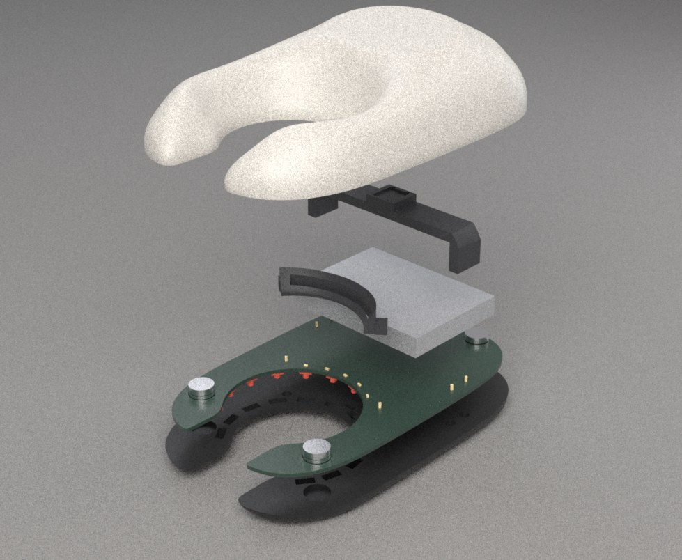
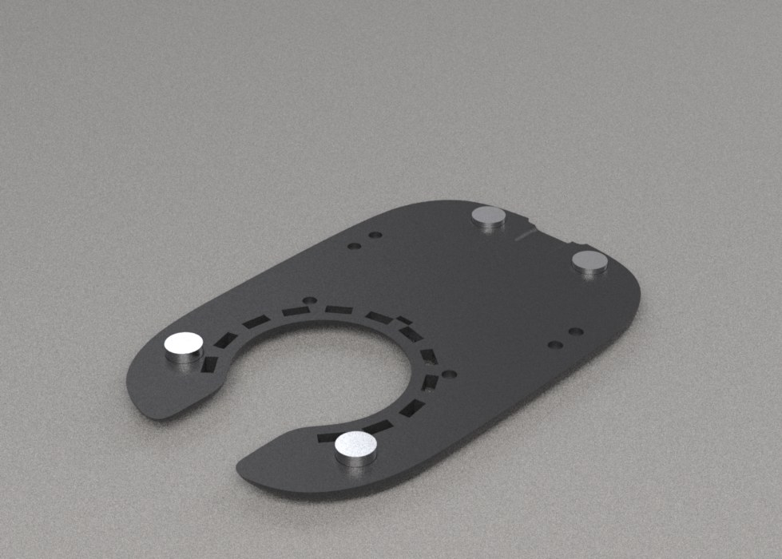
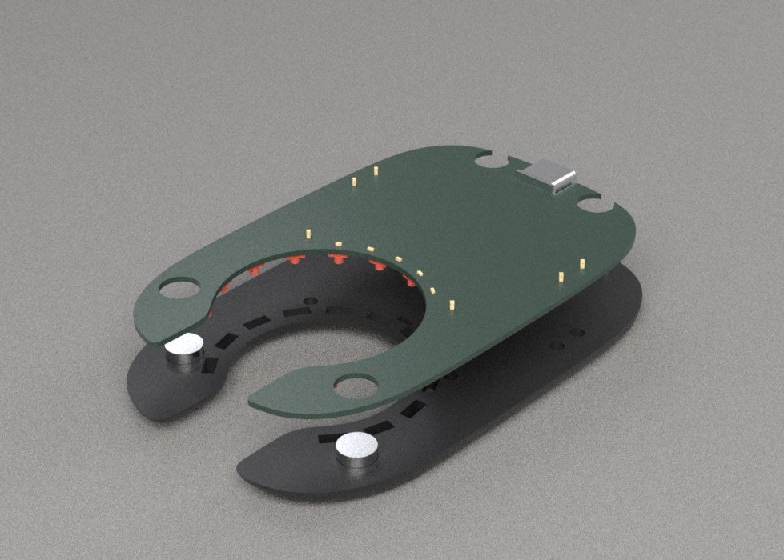
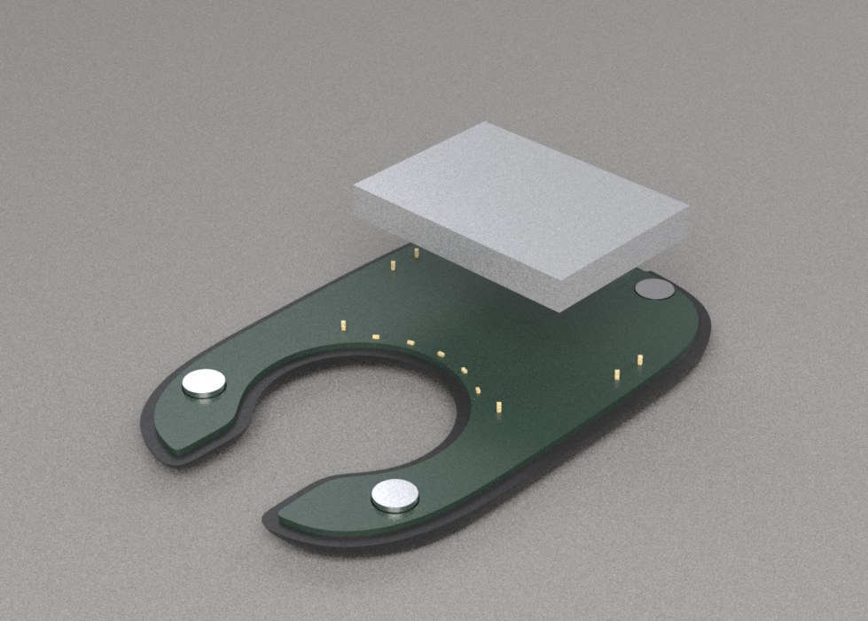
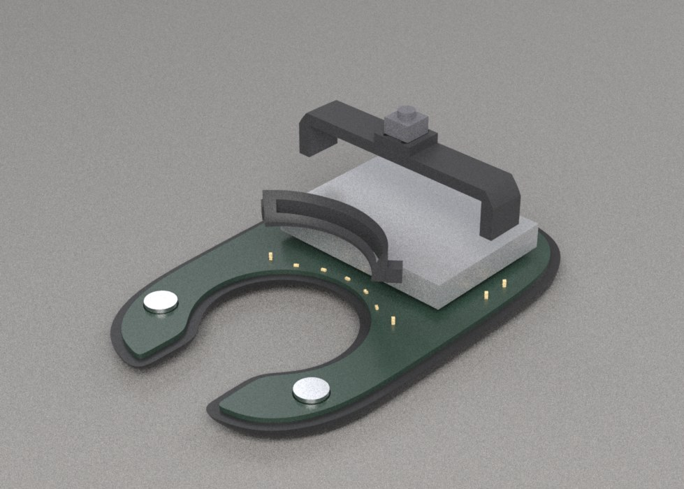
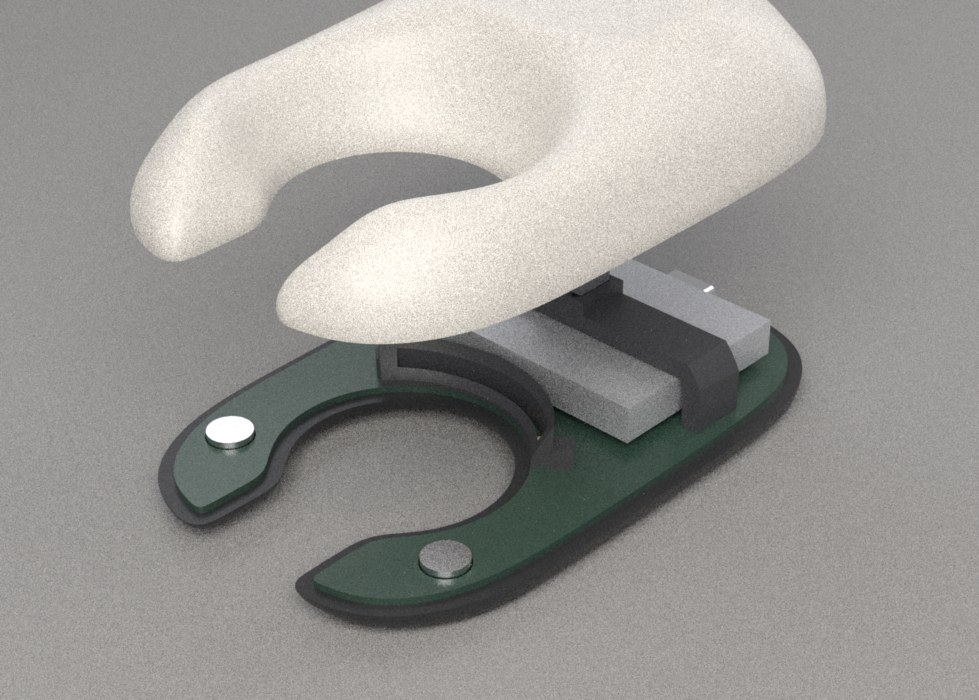

# Build guide — printing and assembly

> **Personal prototype for bench evaluation. Not a cleared medical device.**
> Not for diagnosis, treatment or clinical use. Lithium cell inside: never short, puncture
> or heat it, and charge it only in this device or a proper Li-ion charger.

## What you need

**Bought parts:** see [BOM](../03-electronics/bom.md):
- one Digi-Key order: cell, ring LEDs, MCU, USB-C, magnets, header strip;
- one LCSC order: driver, charger, passives, switch, status LEDs, NTC;
- one Adafruit order: 30 AWG silicone wire, foam tape.

**PCB:** order it from the Gerbers in [`../03-electronics/fab/`](../03-electronics/fab/).
- 2 layers, **1.0 mm thick**, any colour (black matches the sole).
- ENIG or HASL finish, 1 oz copper.
- Upload `vein_finder-gerbers.zip`.

**Tools:**
- fine-tip soldering iron (≤ 350 °C), 0.5 mm solder, flux pen, solder wick;
- fine tweezers, flush cutters;
- multimeter;
- 2-part epoxy or CA glue (for the magnets);
- isopropyl alcohol;
- UPDI programmer: Adafruit UPDI Friend (5879), and a computer with `pymcuprog`.

## 1. Print

Printer: Creality K2 Pro, 0.4 mm nozzle, PETG. The 3MF files are already in print
orientation: [`../02-cad/3mf/`](../02-cad/3mf/).

| | Top shell (warm grey) | Sole (black) | Seam mask (black) | Bridge (black) |
|---|---|---|---|---|
| Orientation | waterline face down | turned over, waterline face down | base down | on its side |
| Layer height | adaptive 0.08–0.16 mm, or a fixed 0.12 | 0.16 mm | 0.12 mm | 0.2 mm |
| Walls | 5 lines (solid 1.8 mm wall) | 4 | 2 (0.8 mm fences) | 3 |
| Infill | 100 % (all wall) | 30 % gyroid | — | 40 % gyroid |
| Top / bottom | 6 / 4 | 6 / 4 | 4 / 3 | 4 / 4 |
| Supports | **tree, build plate only**, for the interior | none | none | none |
| Brim | 3 mm | none | 5 mm | none |

Settings for all parts:
- **Temperatures:** nozzle 235–245 °C, bed 75–80 °C, part fan 30–50 %, bridges 100 %.
  Leave the chamber lid open.
- **Plate:** textured PEI. On smooth PEI, glue stick as a release agent.
- **Flatness:** both waterline faces must be flat. Use first-layer / elephant-foot
  compensation of 0.10–0.15 mm.
- **Thin spots:** turn on "detect thin walls".
  - Check the preview over the 0.40 mm button skin and the 0.7 mm seam.
  - On the sole's skin face, check the NTC's 0.7 mm sensor window: the small rectangle
    just behind the window, at the tail side.
- **Small holes:** the 1.05 mm pin holes in the mask ears and bridge legs print slightly
  undersize. That's intended: the header posts should slide in snugly. If they don't,
  ream with a 1.0 mm drill bit by hand.

Clean up:
- Clip the shell's interior tree supports out through the open waterline face.
- Keep tools away from the button skin and the seam slot.
- Check that the sole's 12 LED channels and the USB-C opening are clear.

## 2. Solder the board

Work top side first, then the underside.

**Order:** small and flat first; tallest and hardest to reach last.

### Top side

1. **U3 (TPS61169, SC-70-5, 0.65 mm pitch).**
   - Tin one corner pad, place the chip with its pin-1 mark on the silkscreen dot, and tack it.
   - Then flux and drag the other pads.
   - Check under a loupe for bridges.
2. **U1 (ATtiny1614, SOIC-14).** Pin 1 is the dot. It sits at the end nearest C3/C4.
3. **U2 (BQ21040, SOT-23-6)**, **Q1/Q2 (SOT-23)**.
4. **0603 resistors and capacitors.** Values are on the silkscreen and in the BOM.
   **R9 is 8.2 Ω (the LED current)**: double-check it before you solder it.
5. **D1 (Schottky).** The band (cathode) goes to the silkscreen's cathode mark.
6. **C5, C6 (1206), C7 (0805), L1 (inductor).**
7. **Status LEDs D14–D18 (amber 0603), in the arc next to the window.** The cathode
   mark goes to the GND pad.
8. **J1 (USB-C).** It drops into the board's cut-out at the tail.
   - Solder the four shell slots first; they carry the plug forces.
   - Then the six pads.

### Underside

9. **Ring LEDs D2–D13 (1206, dome).**
   - **660 nm (XZM2MR55W-3) go on D2–D7; 625 nm (XZM2CRK55W-3) go on D8–D13.** The two
     reels look alike, so keep them apart.
   - Match each LED's cathode mark to the silkscreen. The strings are in series, so one
     reversed LED darkens its whole string.
   - SunLED allows iron soldering at up to 350 °C for 3 s per joint, with no contact with
     the dome. Tin one pad, slide the LED in, then do the other pad.
10. **RT1 (NTC, 0603)**, lying radially between the two LEDs nearest the tail side.

### Check before power

11. **Bridges:** with the multimeter, check VBAT–GND, VBUS–GND and VOUT–GND. None may be
    a short.

## 3. Program and test on the bench

1. Solder the cell's red lead to **BAT+** (TP1) and black to **BAT−** (TP2).
   - Leave about 40 mm of lead.
   - The cell ships part-charged.
2. Solder two 30 AWG wires, about 60 mm long, to **BTN** (TP8) and **BTN_GND** (TP9),
   and touch them together to "press".
3. Programmer:
   - Set the UPDI Friend to **5 V** logic. The cell holds the board at 3.0–4.2 V, and a
     3 V adapter would see up to 4.2 V on its input.
   - Connect only UPDI → TP3 and GND → TP5. The board runs from its own cell; leave the
     programmer's power pin unconnected.
   - Run `make -C fw flash PORT=/dev/ttyACM0`.
4. Test the button:
   - A tap lights the 660 nm string at 40 %. Further taps step up, and the fourth tap
     turns it off.
   - A hold switches to the 625 nm string.
   - The amber seam glows faintly while the device is on.
5. Plug in USB-C: the LEDs go off and the seam breathes (charging).
6. **If a string stays dark:**
   - check the LED orientation;
   - toggle off and on (the driver latches off if a string is open).

## 4. Assemble

Each step renders the parts as they go in; the top shell is shown last.

### 4.1 Magnets into the sole

**Polarity matters: every pair must attract.**
1. Stack each sole magnet on its partner top magnet so they attract.
2. Mark the free face of the sole magnet with a pen dot.
3. Glue the sole magnets in with the **dot up**:
   - two 1/4 × 1/8″ at the horns: these stand proud and act as dowels;
   - two 1/4 × 1/16″ at the tail.
4. The top magnets go in later, **unmarked face down**, so each pair attracts.
5. Use a small dab of epoxy or CA. Let it cure before closing.

### 4.2 Locating pins, then the board

1. Pull six posts out of the header strip with pliers. Push each through its plated hole
   from the top: two at the mask ears, four at the bridge feet.
2. Put the seam mask and the bridge onto their posts. They square them up.
3. Turn the board over, solder each post on the underside, and cut it flush.
4. Lift the mask and bridge off again.
5. Lay the board into the sole:
   - the four magnets pass through the four board holes, which locates it;
   - the LEDs drop into their channels;
   - the NTC drops into its pocket.

### 4.3 Battery

1. Stick one piece of foam tape (Adafruit 5019) on the board inside the "CELL" outline
   on the silkscreen.
2. Press the cell onto it with its leads toward the +y side arm (the battery pads).
3. Dress the leads flat along the board edge.

### 4.4 Seam mask, bridge and button

1. Push the seam mask onto its two posts. It covers the five amber LEDs.
2. Fit the tact switch (B3F-1020) into the bridge's seat: four legs through the four holes.
3. Solder the two button wires to two diagonally opposite legs of the switch, so the
   contacts are in series. Insulate the joints.
4. Push the bridge onto its four posts, so it straddles the cell.
5. **Shim:** with the top shell on, press the dish.
   - You should feel the click within the first 0.3 mm.
   - If there is free play before the click, add a paper shim (80 g/m² paper is about
     0.1 mm) under the switch.

### 4.5 Close

1. Glue the two top magnets into the horn bosses and the two at the tail, polarity as in
   §4.1. Let them cure.
2. Lower the top shell straight down. The horn dowels engage first, then the halves pull
   shut.
3. To open, twist gently at the tail.

## 5. First use

- Charge fully: the seam breathes while charging and glows steadily when full, about 3 h.
- **Use:**
  - Press the window flat onto the skin. Tap to light, tap again for brighter, and hold to
    switch between 660 nm and 625 nm.
  - The light shows best near the rim of the window; dim the room for the centre.
- **Auto-off:** after 3 min without a press.
- **Warning patterns:**
  - Above 38 °C at the face sensor, the light dims.
  - At 41 °C it goes off and the seam double-blinks.
  - A 1 Hz seam blink means the cell is low.

**Cleaning:** wipe the sole with isopropyl alcohol. It is not waterproof.
